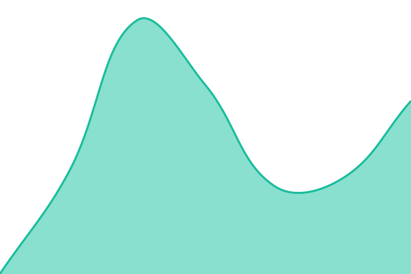

# [📈 Aktueller Status](https://status.finque.de): <!--live status--> **Alle Dienste laufen normal**

This repository contains the open-source uptime monitor and status page for [finflow](https://finflow.io), powered by [Upptime](https://github.com/upptime/upptime).

With [Upptime](https://upptime.js.org), you can get your own unlimited and free uptime monitor and status page, powered entirely by a GitHub repository. We use [Issues](https://github.com/finflow-io/finque-status/issues) as incident reports, [Actions](https://github.com/finflow-io/finque-status/actions) as uptime monitors, and [Pages](https://status.finque.de) for the status page.

## [📈 Live Status](https://demo.upptime.js.org): <!--live status--> **Alle Dienste laufen normal**

<!--start: status pages-->
<!-- This summary is generated by Upptime (https://github.com/upptime/upptime) -->
<!-- Do not edit this manually, your changes will be overwritten -->
<!-- prettier-ignore -->
| URL | Status | History | Response Time | Uptime |
| --- | ------ | ------- | ------------- | ------ |
|  [Entwicklung](https://dev.finque.de) | Erreichbar | [entwicklung.yml](https://github.com/finflow-io/finque-status/commits/HEAD/history/entwicklung.yml) | 

 648ms
     
 | 

<a href="https://status.finque.de/history/entwicklung">100.00%</a>
    

|  [API-Dokumentation](https://developers.finque.de) | Erreichbar | [api-dokumentation.yml](https://github.com/finflow-io/finque-status/commits/HEAD/history/api-dokumentation.yml) | 

 708ms
     
 | 

<a href="https://status.finque.de/history/api-dokumentation">100.00%</a>
    

|  [API](https://tugraidqyulnrqbimxje.supabase.co/functions/v1/api/health) | Erreichbar | [api.yml](https://github.com/finflow-io/finque-status/commits/HEAD/history/api.yml) | 

 1389ms
     
 | 

<a href="https://status.finque.de/history/api">100.00%</a>
    

<!--end: status pages-->

[**Visit our status website →**](https://status.finque.de)

## 📄 License

- Powered by: [Upptime](https://github.com/upptime/upptime)
- Code: [MIT](./LICENSE) © [Anand Chowdhary](https://anandchowdhary.com)
- Data in the `./history` directory: [Open Database License](https://opendatacommons.org/licenses/odbl/1-0/)
